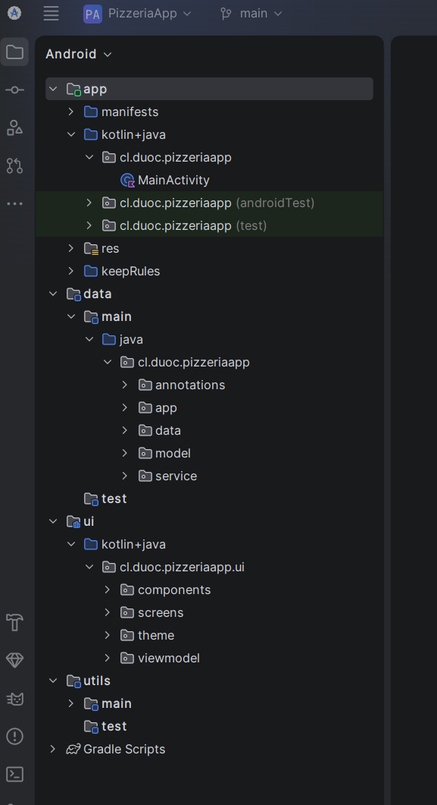
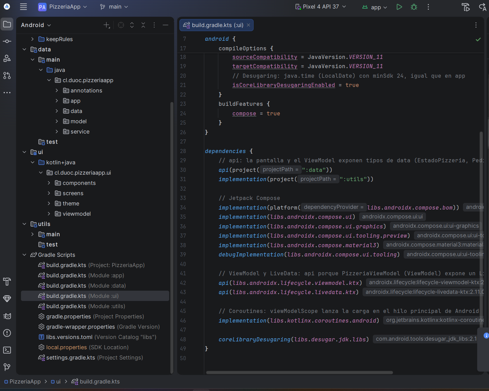
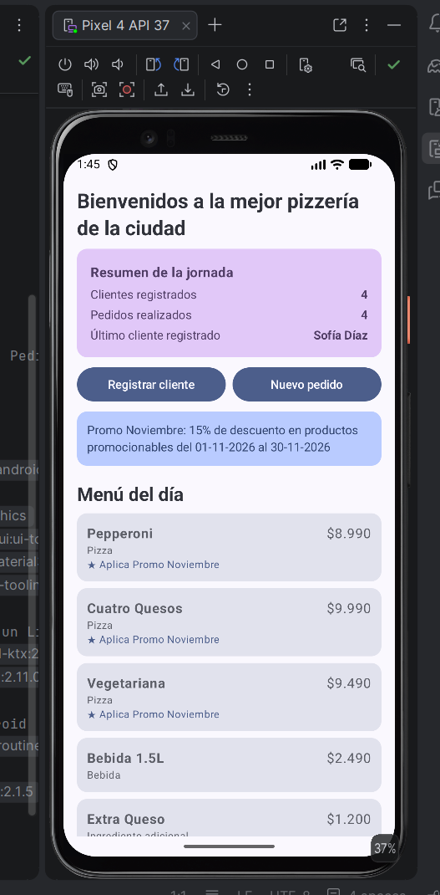
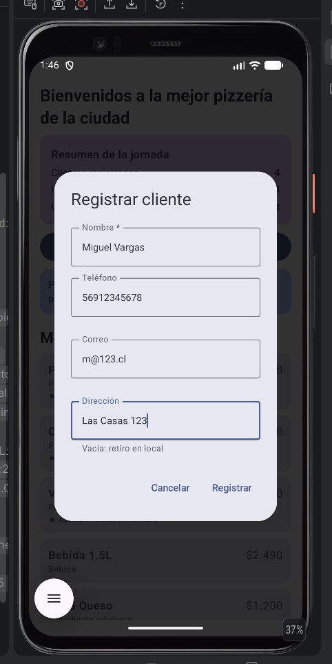
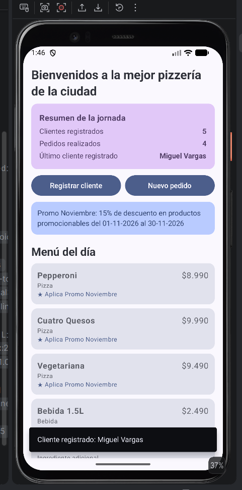
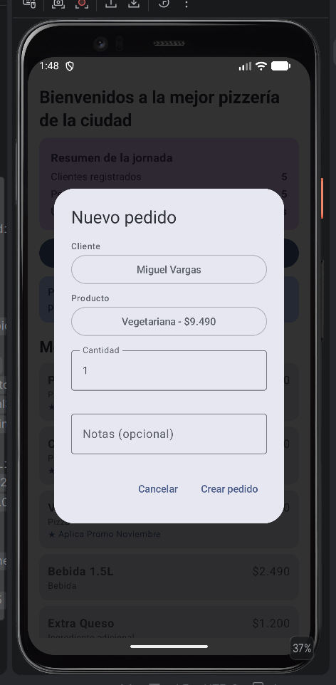
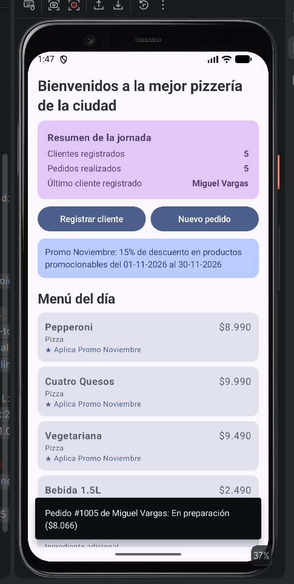
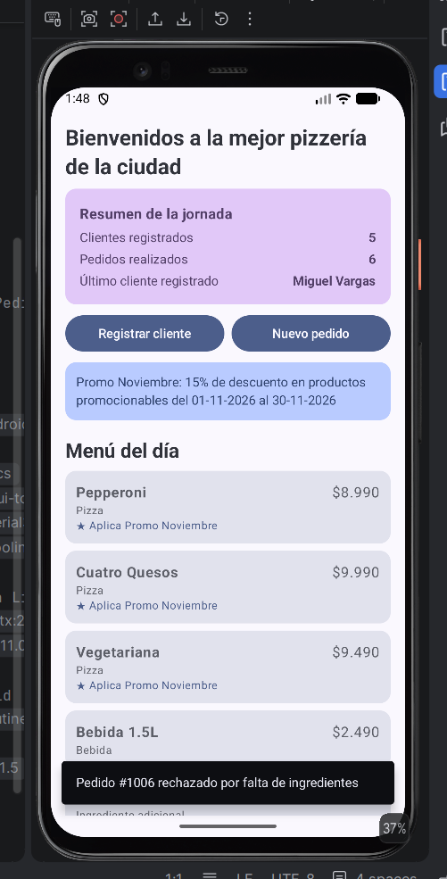
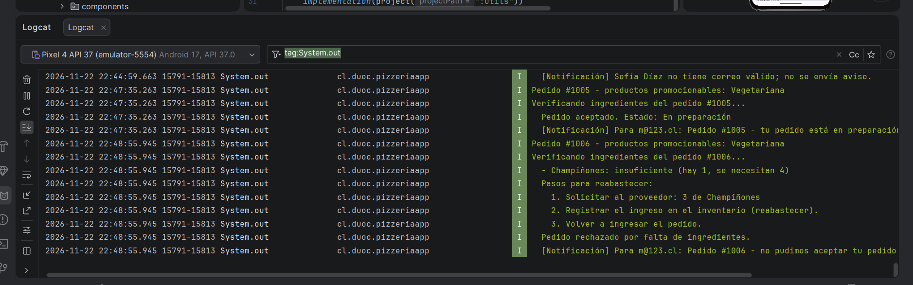

# PizzeriaApp

Aplicación Android en Kotlin que integra la lógica de la pizzería desarrollada en semanas anteriores (PizzeriaKotlin, app de consola) en un proyecto **modular gestionado con Gradle**. La pantalla inicial muestra un **resumen dinámico** (clientes registrados, pedidos realizados y último cliente) que se actualiza al registrar clientes y pedidos desde formularios, además del menú del día, los pedidos procesados y los usuarios registrados.

## Entorno

| Componente | Versión |
|---|---|
| Android Studio | Rabbit 2 \| 2026.2.2 Patch 1 (Build AI-262.10968.63.2622.16840690) |
| Android SDK | `C:\Users\Miguel\AppData\Local\Android\Sdk` |
| SDK Platform | Android 17.0 (API 37) |
| SDK Tools | Android Emulator 37.2.13 · Platform-Tools 37.0.1 · Emulator hypervisor driver 2.2.0 |
| AVD | Pixel 4 · API 37 · Portrait |
| Kotlin / AGP | Kotlin 2.2.10 · Android Gradle Plugin 9.5.1 |
| UI | Jetpack Compose (BOM 2026.02.01) · Material 3 |

## Configuración del proyecto

| Parámetro | Valor |
|---|---|
| Plantilla | Empty Activity (Jetpack Compose) |
| Paquete | `cl.duoc.pizzeriaapp` |
| Lenguaje | Kotlin · Kotlin DSL (`build.gradle.kts`) · catálogo de versiones `gradle/libs.versions.toml` |
| Minimum SDK | API 24 (Android 7.0), configuración usada en clases |
| Target / Compile SDK | API 37 |

## Estructura modular

```
PizzeriaApp/
├── app/      Módulo principal (Android Application)
│   └── MainActivity.kt          Punto de entrada: obtiene el ViewModel, observa sus LiveData y conecta lógica y UI
├── ui/       Módulo de UI (Android Library)
│   ├── screens/                 PizzeriaScreen: pantalla inicial en Jetpack Compose
│   ├── components/              Greeting, ResumenCard, FormularioCliente, FormularioPedido
│   ├── viewmodel/               PizzeriaViewModel: estado y mensajes expuestos con LiveData
│   └── theme/                   Tema Material 3
├── data/     Módulo de datos (Kotlin Library)
│   ├── model/                   Cliente, Producto (Pizza, Bebida, Combo...), Pedido, ItemPedido, Repartidor...
│   ├── service/                 Inventario, Registro, GestionPedidos, Despacho, Notificaciones
│   ├── data/                    Datos iniciales, EstadoPizzeria y PizzeriaRepositorio (suspend + coroutines)
│   ├── app/                     Jornada: estado del día (inventario, menú, repartidores, pedidos)
│   └── annotations/             @Promocionable e Inspector (lectura por reflection)
└── utils/    Módulo de utilidades (Kotlin Library)
    └── utils/                   Validaciones (Regex), formato de moneda y fecha
```

**Dependencias entre módulos** (`settings.gradle.kts` declara `:app`, `:data`, `:ui` y `:utils`):

```
app ──► ui ──► data ──► utils
 │       └──────────────► utils
 └──► data, utils
```

- `:utils` no depende de ningún otro módulo ni del dominio: se puede reutilizar tal cual.
- `:data` es Kotlin puro (sin Android): contiene la lógica de negocio y puede probarse con pruebas unitarias en la JVM.
- `:ui` expone `:data`, ViewModel y LiveData como `api`, porque sus clases públicas usan esos tipos.
- `Inspector.kt` se movió de `utils` a `data/annotations`: conoce `Producto` y `@Promocionable`, y dejarlo en `:utils` habría creado una dependencia circular.

## Configuración de Gradle

| Archivo | Contenido relevante |
|---|---|
| `settings.gradle.kts` | `include(":app")`, `include(":data")`, `include(":ui")`, `include(":utils")` |
| `build.gradle.kts` (raíz) | Plugins `android.application`, `android.library`, `kotlin.compose` y `jetbrains.kotlin.jvm` (`apply false`) |
| `gradle/libs.versions.toml` | Versiones centralizadas; el plugin Kotlin JVM usa la misma versión `kotlin` que el plugin de Compose |
| `app/build.gradle.kts` | `project(":ui")`, `project(":data")`, `project(":utils")`, Compose, `runtime-livedata` (`observeAsState`) |
| `ui/build.gradle.kts` | Compose + Material 3, `lifecycle-viewmodel-ktx`, `lifecycle-livedata-ktx`, `kotlinx-coroutines-android` |
| `data/build.gradle.kts` | `project(":utils")`, `kotlinx-coroutines-core`, JUnit 4 (`testImplementation`) |
| `utils/build.gradle.kts` | Kotlin JVM, Java 11 |

Los módulos Android (`app`, `ui`) habilitan *core library desugaring* para usar `java.time.LocalDate` con minSdk 24.

## Flujo de datos: lógica → UI

```
PizzeriaRepositorio (data)  ──suspend──►  PizzeriaViewModel (ui)  ──LiveData──►  MainActivity (app)  ──estado──►  PizzeriaScreen (ui)
        ▲                                         │                                                                │
        └──────────── registrarCliente / crearPedido ◄──────────────── callbacks de los formularios ◄──────────────┘
```

1. `PizzeriaRepositorio` procesa la jornada en `Dispatchers.Default` (funciones `suspend`, con `Mutex` para operaciones consecutivas) y entrega un `EstadoPizzeria`.
2. `PizzeriaViewModel` llama al repositorio con `viewModelScope.launch` y publica el resultado en `LiveData<EstadoPizzeria>`, además de un `LiveData` con el mensaje de cada operación.
3. `MainActivity` obtiene el ViewModel con `by viewModels()` (sobrevive a la rotación) y lo observa con `observeAsState()`.
4. `PizzeriaScreen` se recompone con cada estado nuevo; los formularios envían sus datos de vuelta al ViewModel.

## Pantalla inicial

- **Bienvenida**: "Bienvenidos a la mejor pizzería de la ciudad".
- **Resumen de la jornada**: total de clientes registrados, total de pedidos realizados y nombre del último cliente registrado. Se actualiza en cuanto se registra un cliente o un pedido.
- **Registrar cliente**: formulario con nombre (obligatorio), teléfono, correo y dirección; valida teléfono y correo en vivo con las funciones de `:utils`. Sin dirección, el pedido queda como retiro en local.
- **Nuevo pedido**: cliente y producto se eligen de las listas registradas; cantidad entre 1 y 100. El pedido toma el siguiente correlativo (#1005 en adelante) y la fecha actual; el inventario lo deja *En preparación* o *Rechazado* por falta de ingredientes.
- **Snackbar** con el resultado de cada operación.
- **Promo Noviembre**, **Menú del día** (productos promocionables marcados con "★ Aplica Promo Noviembre"), **Pedidos del día** con descuentos, IVA y repartidor, **Resumen de ventas** y **Usuarios registrados**.

## Ejecución

1. Abrir la carpeta del proyecto en Android Studio y esperar el **Gradle sync**.
2. Iniciar el AVD **Pixel 4 API 37** desde **Tools > Device Manager**.
3. Seleccionar el dispositivo y presionar **Run 'app'** (`Shift + F10`).
4. Los mensajes de la lógica (inventario, notificaciones y despacho) se ven en **Logcat** con el filtro `tag:System.out`.

## Pruebas

### Pruebas en el emulador

| Acción | Resultado esperado |
|---|---|
| Abrir la app | Resumen: 4 clientes, 4 pedidos, último cliente Sofía Díaz |
| Registrar un cliente con datos válidos | Resumen: 5 clientes y el nombre nuevo como último cliente; aparece en Usuarios registrados |
| Crear un pedido de 1 Vegetariana | Pedido #1005 *En preparación* con Promo Noviembre; resumen: 5 pedidos |
| Crear un pedido de 2 Vegetarianas | *Rechazado*: quedan 3 champiñones y se necesitan 4 |

### Pruebas unitarias (módulo `:data`)

Ejecutar desde Android Studio (clic derecho en `data/src/test/java` > **Run 'Tests in ...'**) o por terminal:

```
.\gradlew :data:test
```

| Clase | Qué valida |
|---|---|
| `PedidoCalculosTest` | Subtotal, descuento del 10% con más de 3 pizzas (cuentan las de los combos), Promo Noviembre del 15% sobre productos promocionables, desglose y redondeo del IVA, rango de cantidades |
| `PedidoEstadosTest` | Estado inicial, estados finales sin cambios, asignación de repartidor solo a pedidos listos, flujo de despacho y entrega |
| `InventarioTest` | Aceptación con descuento de stock, rechazo sin descontar, reabastecimiento inválido |
| `RegistroTest` | Normalización de nombre, teléfono y correo, valores por defecto, retiro en local, clientes duplicados, orden de registro |
| `PizzeriaRepositorioTest` | Datos del resumen inicial, carga sin duplicados, actualización al registrar clientes y pedidos, rechazo por inventario |

## Mejoras aplicadas desde la retroalimentación de la semana 4

| Recomendación | Implementación |
|---|---|
| Formularios para registrar clientes y pedidos | `FormularioCliente` y `FormularioPedido`, con validación en vivo |
| Pruebas unitarias de descuentos, IVA y estados | 5 clases de prueba en `data/src/test` |
| ViewModel para administrar el estado de la interfaz | `PizzeriaViewModel` con `LiveData` (tecnología solicitada en la semana 5) y repositorio con coroutines |

## Evidencias (semana 5)

Estructura modular del proyecto:


Dependencias de Gradle del módulo UI:


Pantalla inicial con el resumen:


Registro de un cliente y actualización del resumen:



Creación de un pedido y actualización dinámica de los datos:



Pedido rechazado por falta de ingredientes:


Logcat con el procesamiento de los pedidos:


Pruebas unitarias del módulo `:data` (28 pruebas aprobadas):


Capturas de la semana 4 en [`capturas/`](capturas/): instalación (01–07), proyecto (08–09, 13), AVD (10–11) y ejecución (12, 14–15).
