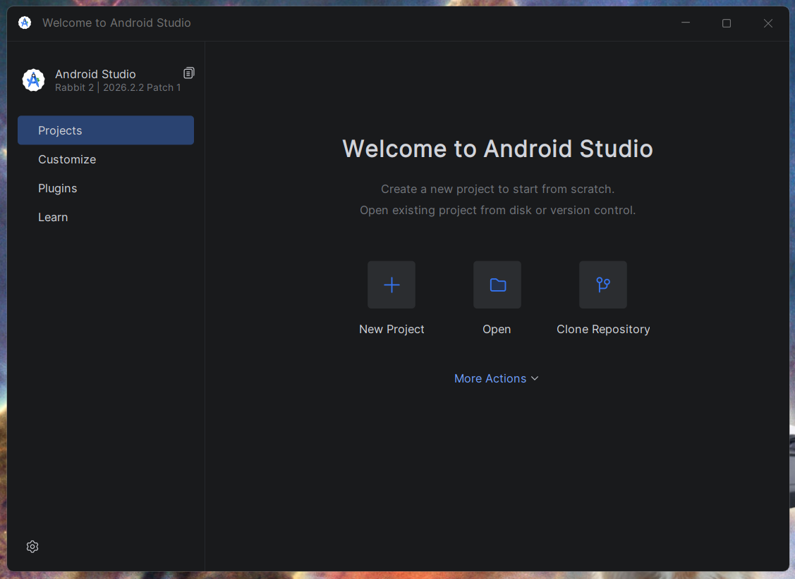
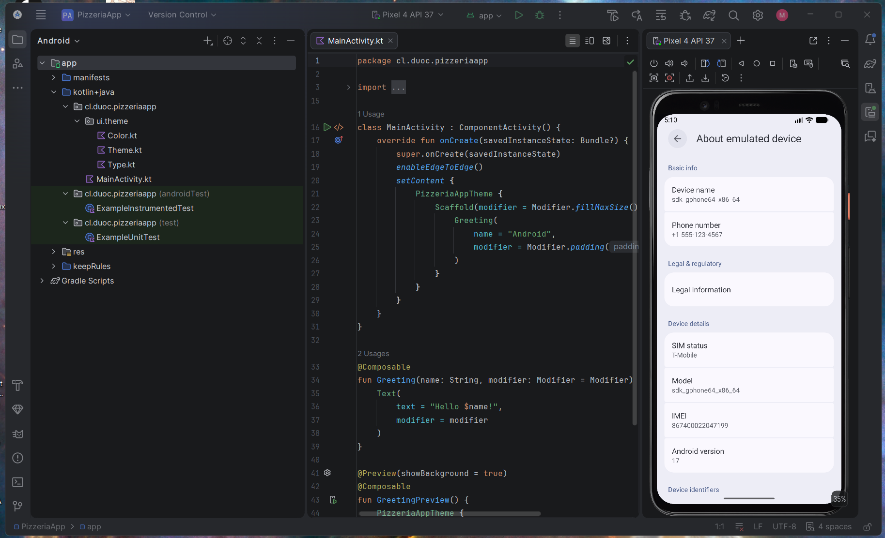
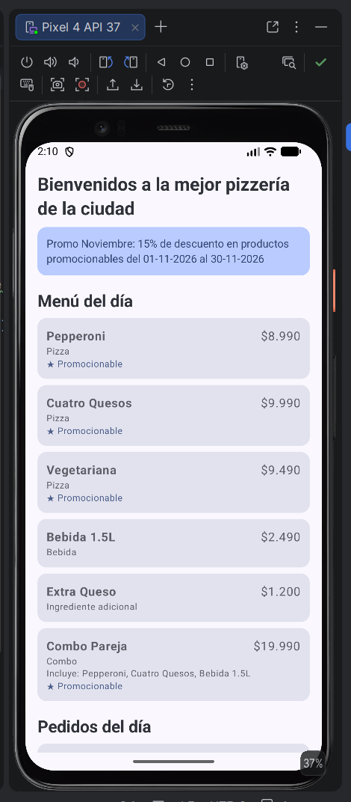

# PizzeriaApp

Aplicación Android en Kotlin que integra la lógica de la pizzería desarrollada en semanas anteriores (PizzeriaKotlin, app de consola) en un entorno móvil. Al ejecutarse muestra el mensaje **"Bienvenidos a la mejor pizzería de la ciudad"**, el menú del día, los pedidos del día procesados y los usuarios registrados.

## Entorno

| Componente | Versión |
|---|---|
| Android Studio | Rabbit 2 \| 2026.2.2 Patch 1 (Build AI-262.10968.63.2622.16840690) |
| Android SDK | `C:\Users\Miguel\AppData\Local\Android\Sdk` |
| SDK Platform | Android 17.0 (API 37) |
| SDK Tools | Android Emulator 37.2.13 · Platform-Tools 37.0.1 · Emulator hypervisor driver 2.2.0 |
| AVD | Pixel 4 · API 37 · Portrait |
| Kotlin / AGP | Kotlin 2.2.10 · Android Gradle Plugin 9.5.1 |
| UI | Jetpack Compose (BOM 2026.02.01) · Material 3 |

## Configuración del proyecto

| Parámetro | Valor |
|---|---|
| Plantilla | Empty Activity (Jetpack Compose) |
| Nombre | PizzeriaApp |
| Paquete | `cl.duoc.pizzeriaapp` |
| Lenguaje | Kotlin · Kotlin DSL (`build.gradle.kts`) |
| Minimum SDK | API 24 (Android 7.0), configuración usada en clases; cumple el requisito de API 21 o superior |
| Target / Compile SDK | API 37 |

## Ejecución

1. Abrir la carpeta del proyecto en Android Studio y esperar el **Gradle sync**.
2. Iniciar el AVD **Pixel 4 API 37** desde **Tools > Device Manager**.
3. Seleccionar el dispositivo y presionar **Run 'app'** (`Shift + F10`).
4. Los mensajes que imprime la lógica (verificación de inventario, notificaciones y despacho) se ven en **Logcat** filtrando por `tag:System.out`.

## Estructura

```
app/src/main/java/cl/duoc/pizzeriaapp/
├── MainActivity.kt          # Punto de entrada; Greeting con el mensaje de bienvenida
├── annotations/             # @Promocionable
├── app/                     # Jornada: inventario, menú, repartidores, registro y pedidos del día
├── data/                    # Datos iniciales: inventario, menú, repartidores, clientes y pedidos precargados
├── model/                   # Usuario, Cliente, Repartidor, Producto, Pizza, Bebida, Combo, Pedido, ItemPedido...
├── service/                 # Inventario, Registro, GestionPedidos, Despacho, Notificaciones
├── ui/
│   ├── screens/             # PizzeriaScreen: pantalla principal en Compose
│   └── theme/               # Tema generado por la plantilla
└── utils/                   # Formato de moneda y fecha, validaciones (Regex), reflection de anotaciones
```

## Integración de la lógica previa

| Origen (PizzeriaKotlin) | Cambio en PizzeriaApp |
|---|---|
| Paquetes de primer nivel (`model`, `service`...) | Reubicados bajo `cl.duoc.pizzeriaapp.*` |
| `model/`, `data/`, `app/`, `service/` (Inventario, Registro, GestionPedidos, Despacho, Notificaciones) | Sin cambios de lógica |
| `java.time.LocalDate` (nativo desde API 26) | *Core library desugaring* habilitado para usarlo con minSdk 24 |
| `utils/Inspector.kt` con `kotlin.reflect.full` | Lectura de `@Promocionable` con reflection de Java (`getAnnotation`), sin depender de `kotlin-reflect` |
| `service/Reportes.kt`, `ResumenAvanzado.kt` (salida por consola) | Reemplazados por `PizzeriaScreen` |
| `ui/Consola.kt`, `ui/MenuPrincipal.kt`, `demo/`, `Main.kt` (`readln`, `main`) | No migrados: la interacción por consola no aplica en Android |

## Pantalla principal

- **Bienvenida**: `Greeting` modificada con el mensaje solicitado.
- **Promo Noviembre**: periodo y porcentaje de descuento vigente.
- **Menú del día**: catálogo con categoría, precio, contenido de combos y marca ★ para productos `@Promocionable`.
- **Pedidos del día**: pedidos precargados procesados hasta su estado (#1001 Entregado, #1002 En camino, #1003 Listo, #1004 Rechazado por falta de champiñones), con descuentos, IVA incluido, total y repartidor.
- **Resumen**: entregados, en curso, rechazados y total vendido.
- **Usuarios registrados**: clientes y repartidores tratados como `Usuario` (polimorfismo con `describir()`).

## Evidencias

Android Studio instalado correctamente:


AVD Pixel 4 en funcionamiento:


Ejecución de la aplicación con el mensaje de bienvenida y la lógica integrada:


Capturas de apoyo en [`capturas/`](capturas/): instalación (01–03), versión y SDK (05–07), proyecto (08–09, 13), configuración del AVD (10), primera ejecución (12) y Logcat (15).
